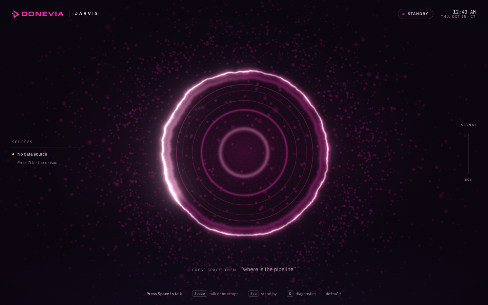
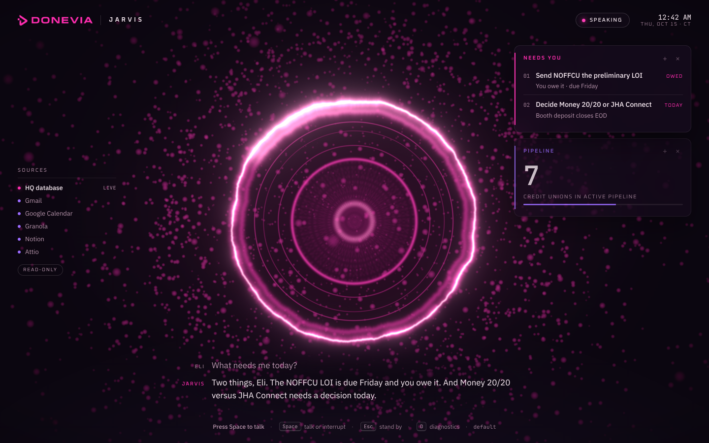

# Donevia Jarvis

A voice companion for Donevia HQ that runs on your Mac. Say "Jarvis" (or press
Space), ask a question out loud, and Jarvis answers in a calm British voice
from what is in HQ, your calendar, mail, meeting notes and CRM. It can also put
a view on the HQ wall ("show the pipeline on HQ").

It only reads. It cannot send, draft, schedule, edit or delete anything.



## What it does

- **Answers from HQ first.** Questions like "what needs me today", "what's
  next", "where is the pipeline", "what do I owe people" are answered from the
  Donevia HQ database, then from your claude.ai connectors (Gmail, Google
  Calendar, Granola, Notion, Attio, Google Drive) when HQ does not have it.
- **Talks like HQ.** Short, verdict first, addressed to you. Numbers spoken the
  way people say them. If something is stale or missing it says so instead of
  guessing.
- **Shows as well as tells.** A short list or a figure appears as a card beside
  the reactor while Jarvis speaks.
- **Drives the HQ display.** "Show the pipeline on HQ", "brief me on the wall",
  "open NOFFCU on HQ": Jarvis sends HQ a display command, and HQ shows it.
- **Lets you interrupt.** Start talking (or press Space) while Jarvis is
  speaking and he stops.



*The screenshot above uses sample content to show the card design.*

## Set up (5 steps)

You need a Mac, about 15 minutes, and the claude.ai account that owns Donevia HQ.
You do not need to install Claude Code separately: Jarvis brings its own copy.

1. **Get the folder.** Put the `donevia-jarvis` folder in your home folder, so
   it is at `~/donevia-jarvis`. If it came as `donevia-jarvis.zip` (download,
   AirDrop or email), double-click the zip in Downloads and drag the folder that
   appears into your home folder (Finder > Go > Home). If it came as a Git
   repository, clone it there instead:
   `git clone <repository link> ~/donevia-jarvis`.
2. **Install Node.js.** Go to <https://nodejs.org>, download the macOS "LTS"
   installer and run it. (If you already have Node, it must be 22.12 or newer,
   or 20.19 or newer; the launcher checks and says so.)
3. **Install Google Chrome** if you do not have it: <https://www.google.com/chrome>.
4. **Let macOS open the launcher (once).** A folder that came from a download,
   AirDrop or email is marked by macOS as "from the internet", and on macOS 15
   (Sequoia) and later the old right-click > Open trick no longer works. Open
   Terminal (Spotlight: type Terminal) and paste this line, then press Return:

   ```
   xattr -dr com.apple.quarantine ~/donevia-jarvis
   ```

   (If you skip this and macOS says it "cannot be opened", go to System Settings
   > Privacy & Security, scroll down and click **Open Anyway** next to "Start
   Donevia Jarvis.command".) A folder you cloned with `git` does not need this.
5. **Double-click `Start Cortana.command`** in the folder. The first time
   it installs packages (a few minutes), then checks everything. If you are not
   signed in to Claude yet, it opens the Claude sign-in page in your browser:
   choose your Claude account (the one that owns HQ) and approve, then come back
   to the Terminal window. If anything else is missing it prints numbered fixes
   and stops. When it is ready, a Jarvis window opens. Click it and allow the
   microphone when Chrome asks.

From Terminal the same steps are `npm run setup` (check only), `npm run login`
(sign in) and `npm start`.

To stop Jarvis, close the Terminal window (or press Ctrl-C in it). If it was
started at login instead (see below), there is no Terminal window; see
"Start at login" for how to stop it.

## Talking to Jarvis

| Do this | What happens |
| --- | --- |
| Say **"Jarvis"**, or press **Space**, or click the ring | He answers ("Yes, Eli?") and listens |
| "Jarvis, what needs me today?" | Asks in one breath |
| Talk while he is speaking, or press **Space** | He stops and listens |
| **Esc** | Stand by |
| **D** | Diagnostics: data path, wake word, voice, microphone |
| **T** | Speaks a test line (checks the sound) |
| **V** | Next Kokoro voice, live (remembered); the next macOS voice while Kokoro is not ready |
| **Shift+V** | Next macOS voice (the stand-in while Kokoro loads) |

Things to say:

- "What needs me today?" / "What do I owe people?"
- "What's next on my calendar?" / "Brief me on my next meeting."
- "Where is the pipeline?" / "Anything new from NOFFCU?"
- "What did we agree with Ascend?"
- "Show the pipeline on HQ." / "Brief me on the wall." / "Open NOFFCU on HQ."

### How the wake word works

The bottom of the screen says which mode is active.

- **Say "Jarvis"** when Chrome can recognise speech on the Mac itself (recent
  Chrome). Nothing you say leaves the Mac while Jarvis is waiting. The very
  first time, Chrome downloads a small speech pack (about 60 MB): the footer
  says "Press Space to talk · "Jarvis" after the speech pack loads", and
  Jarvis switches to the wake word by himself as soon as it arrives.
- **Press Space** otherwise. The microphone is only transcribed during a
  conversation, never while Jarvis is idle.
- Optional: a Picovoice key gives an offline "Jarvis" detector. Add
  `PICOVOICE_ACCESS_KEY=...` to your settings (see [Settings](#settings)) and
  follow `public/picovoice/README.md`. It is not needed.

During a conversation, Chrome transcribes what you say. On a Mac without the
on-device pack, that audio goes to Google's speech service, the same as
dictation in Chrome.

### The voice

Jarvis speaks with **Kokoro** (British voice "Emma" to start), a neural
voice that runs inside Chrome. Nothing is sent anywhere to speak. The first
start downloads the voice model once (90 to 330 MB, from huggingface.co); the
download begins as soon as the window opens. Until it is ready, and on a Mac
too slow to run it smoothly, Jarvis uses the macOS voice instead, and the
footer says so: "Mac voice: Kokoro loading 42%", or "Kokoro too slow on this
Mac, using Mac voice". Press D to see how fast Kokoro runs.

**Changing the voice:** press **V**. Jarvis switches to the next Kokoro voice
straight away, says a line in it, and remembers it in this window's browser
profile. The voices, V starts with Emma and Isabella, then the rest:

| Voice | | Voice | |
| --- | --- | --- | --- |
| `bm_george` George | British male | `af_nicole` Nicole | American female, soft |
| `af_heart` Heart | American female, best rated | `am_puck` Puck | American male |
| `af_bella` Bella | American female | `bm_fable` Fable | British male |
| `am_michael` Michael | American male | `bf_isabella` Isabella | British female |
| `bf_emma` Emma | British female (default) | `bm_lewis` Lewis | British male |
| `am_fenrir` Fenrir | American male | `bm_daniel` Daniel | British male |

Each voice downloads about half a megabyte the first time it is used.
**Shift+V** steps through the macOS voices instead (the stand-in while Kokoro
loads); the free "Daniel (Enhanced)" voice (System Settings > Accessibility >
Spoken Content > Manage Voices) sounds much better than the stock one. To
start with a different Kokoro voice, set `JARVIS_KOKORO_VOICE` in your settings;
changing that line replaces an earlier V pick.

To use the macOS voice only, set `JARVIS_TTS_ENGINE=system` in your settings
(see [Settings](#settings)).

## Privacy and the read-only guarantee

- **Runs on your Mac.** The bridge and the page listen on 127.0.0.1 only;
  nothing on your network can reach them.
- **Only the Jarvis window can use it.** Each start makes a new secret and
  hands it to the Jarvis window only (in the part of the address after `#`,
  which never leaves the browser). The bridge refuses anything without it, and
  only accepts the page at `http://127.0.0.1:5173`. Websites you visit, and
  other web projects running on this Mac, cannot talk to Jarvis or read what it
  reads. One Jarvis window at a time; a second one takes over from the first.
- **Uses your Claude login.** Questions go to Claude through Claude Code, signed
  in as you, the same as typing them into Claude. There is no API key, and the
  bridge removes `ANTHROPIC_API_KEY` from its environment so usage always goes
  through your claude.ai plan.
- **Reads only.** Every tool call is checked twice (a hook and a permission
  check, in `bridge/policy.mjs`) against an allow-list of read tools. Anything
  that sends, drafts, replies, forwards, creates, updates, deletes, labels,
  trashes or responds is refused, in Gmail, Google Calendar, Notion, Granola,
  Attio, Drive, DocuSign, Mercury, QuickBooks, Klaviyo and Shopify. Mercury,
  QuickBooks, DocuSign, Klaviyo and Shopify are off entirely. Claude Code's
  shell, file editing, web and browser tools are off. There is no setting that
  turns writes on.
- **No back doors through Claude Code.** Claude Code treats a message starting
  with `/` as one of its own commands (some of which change its settings), and
  `@file` as "attach this file". Jarvis refuses the first and defuses every
  `@` that is not part of an email address before anything reaches Claude
  Code. A test runs Claude Code's own mention patterns against this, and fails
  if a Claude Code update changes them.
- **No transcripts.** Jarvis tells Claude Code not to save conversations to
  disk, so what it reads (mail, notes, CRM, HQ) is not left in files on your
  Mac or in its backups.
- **One narrow write.** The only thing Jarvis can write is a display command to
  the HQ database (`commands/`): one of a fixed list such as "show pipeline",
  "brief me", "what's next", "what do I owe", "where are we with NOFFCU" or
  "wall mode", timestamped now, marked as coming from the companion, one at a
  time. Organisation names ("fly to NOFFCU") are letters only, so a code or an
  account number cannot be written into HQ. It cannot queue tasks for HQ's
  agents, start them, or change or delete any other HQ data, even if an email
  it reads asks it to.
- **Text-only cards.** Cards on screen can show text only. They cannot load
  images, pages or anything else from the internet, and the page refuses to
  run any script that is not part of Jarvis itself.
- **No keys in files.** Settings live in `Jarvis settings.txt` (or
  `.env.local`), which are never committed.

## Start at login (optional)

Not installed automatically. Double-click the launcher once first, so the
packages are installed and you are signed in. Then, if you want Jarvis to start
when you log in, open Terminal and paste this whole block (it assumes the folder
is at `~/donevia-jarvis`):

```
mkdir -p ~/Library/LaunchAgents && cd ~/donevia-jarvis && \
sed -e "s#__JARVIS_DIR__#$PWD#" -e "s#__HOME__#$HOME#" docs/launchagent/io.donevia.jarvis.plist \
  > ~/Library/LaunchAgents/io.donevia.jarvis.plist && \
launchctl bootstrap gui/$(id -u) ~/Library/LaunchAgents/io.donevia.jarvis.plist
```

It runs the same launcher as a double-click (so it finds Node and repairs the
packages after an update), just without a Terminal window. Its messages go to
`~/Library/Logs/donevia-jarvis.log`.

While it runs this way there is no Terminal window to close. In Terminal:

| To | Paste |
| --- | --- |
| Stop Jarvis for now | `launchctl kill TERM gui/$(id -u)/io.donevia.jarvis` |
| Restart it (after changing settings) | `launchctl kickstart -k gui/$(id -u)/io.donevia.jarvis` |
| Stop starting it at login | `launchctl bootout gui/$(id -u)/io.donevia.jarvis && rm ~/Library/LaunchAgents/io.donevia.jarvis.plist` |

Double-clicking the launcher while it runs just brings the Jarvis window back.

## Troubleshooting

Press **D** in the Jarvis window first: it says which data source is in use,
whether the microphone is hearing you and whether speech is playing.

| Problem | Fix |
| --- | --- |
| macOS says the .command "cannot be opened" | Run the `xattr` line from step 4, or System Settings > Privacy & Security > **Open Anyway**. |
| "You do not have appropriate access privileges" | The file lost its "can run" flag on the way over. In Terminal: `chmod +x ~/donevia-jarvis/*.command`, then double-click again. |
| "No data source" on the left | Run `npm run setup`. Usually Claude Code is not signed in with your claude.ai account: run `npm run login`. |
| "This window was not opened by the launcher" | Close that window and double-click the .command (it opens the right one). Bookmarks to `127.0.0.1:5173` do not work on their own. |
| "Cannot reach the bridge" after restarting Jarvis | The window is from the earlier start. Close it; the new start opens a fresh one. |
| "Jarvis is open in another window" | Only one Jarvis window works at a time. Close the extra one, or ask a question here to take over. |
| HQ shows "ready" but not "live" | Normal until your first question; it confirms the HQ database then. |
| He does not react to "Jarvis" | The footer probably says "Press Space to talk": use Space, or update Chrome. Check Chrome has microphone access (System Settings > Privacy & Security > Microphone). |
| A blank window, or "Starting Donevia Jarvis…" that never goes away | The page's files did not load (usually a window left over from an earlier start). Close it and double-click the .command again; if it repeats, run `npm run setup`. |
| No sound | Press T. Check the Mac's volume and output device. Press D and look at "Speaking". |
| The voice sounds robotic | That is the macOS voice: the footer says why (Kokoro still loading, too slow, or failed). It switches to Kokoro by itself once ready. Press V to try other Kokoro voices. |
| "Port 8787 is in use by another program" (or 5173) | Another app is using that port (often another web project). Quit it or restart the Mac. For 8787 you can also set `JARVIS_BRIDGE_PORT=8788` in your settings. If Jarvis itself is already running, the .command just reopens its window. |
| "Node.js is too old" | Install the current LTS from <https://nodejs.org>, close the Terminal window, double-click again. |
| "Settings file cannot be read" | It was saved as rich text. Open it in TextEdit, choose Format > Make Plain Text, save, restart Jarvis. |
| He says "Press Space to talk" the first time | Chrome is still fetching its speech pack. Press Space for now; "Jarvis" starts working by itself when it arrives. |
| Packages problem, or a crash right after "installing packages" | Double-click the .command again: it notices an unfinished install and repairs it. By hand: `rm -rf node_modules && npm ci`. |
| A connector is missing | Connect it at claude.ai > Settings > Connectors, then restart Jarvis. |
| "Bridge connection lost" | The Terminal window was closed. Double-click the .command again. |

`npm run setup` checks Node, the packages, Chrome, Claude Code and the login,
which data source is available, the voice download and the ports, and prints
what to fix. It changes nothing and uses no Claude usage.

## Settings

All optional; Jarvis runs fine without any. To change one, run this in
Terminal:

```
cd ~/donevia-jarvis && npm run settings
```

It makes a file called `Jarvis settings.txt` in the folder (the first time) and
opens it in TextEdit. Every setting is listed with a `#` in front, which means
"off". Delete the `#` and change the value, for example
`JARVIS_TTS_ENGINE=system`. Save, then restart Jarvis. Quotes are not needed;
TextEdit's curly quotes are fine too. (Developers can use `.env.local`
instead; `Jarvis settings.txt` wins if both exist.)

The useful ones:

| Setting | Default | |
| --- | --- | --- |
| `JARVIS_TTS_ENGINE` | `kokoro` | `system` for the macOS voice only |
| `JARVIS_KOKORO_VOICE` | `bf_emma` | Starting voice; any id in [The voice](#the-voice). V changes it live |
| `JARVIS_WAKE` | `auto` | `off` for Space only; `cloud` for always-on Google speech |
| `PICOVOICE_ACCESS_KEY` | none | Optional offline wake word |
| `JARVIS_MODEL` | `sonnet` | The Claude model |
| `DONEVIA_HQ_URL` | Donevia HQ | The HQ artifact to read |

## For developers

```
npm ci
npm run setup     # readiness check
npm run settings  # make / open "Jarvis settings.txt"
npm run login     # sign Claude Code in (bundled copy, opens the browser)
npm start         # builds the face if needed, serves it, starts the bridge, opens Chrome
npm run dev       # face on the Vite dev server (hot reload, looser CSP); run npm run bridge alongside
npm test          # policy, access, mention and data-path unit tests (node --test)
npm run build     # tsc + vite build
npm run lint      # oxlint
```

- `bridge/server.mjs`: the local bridge. One Claude Code session per window,
  through the Claude Agent SDK, with no filesystem settings.
- `bridge/policy.mjs`: the read-only gate (`decideTool`), used by a PreToolUse
  hook and by `canUseTool`, including the closed list of HQ display commands.
- `bridge/access.mjs`, `bridge/ask.mjs`: who may connect (Host, Origin, launch
  token) and what may be sent to Claude Code (no slash commands).
- `bridge/datapath.mjs`, `bridge/probe.mjs`: which data source is available, in
  order: HQ database (ArtifactData), claude.ai connectors, MCP servers from
  `~/.claude.json`. Checked at start without spending usage; shown in the
  diagnostics panel and the bridge log.
- `bridge/persona.mjs`: Jarvis's instructions.
- `bridge/panels.mjs`: the `display` card tool and the `hq_command` helper.
- `src/`: the face (React, three.js). `src/lib/voice.ts` (listening),
  `src/lib/tts.ts` and `src/lib/kokoro.ts` (speaking).

### Note for HQ

HQ v7 runs only commands with `from: "remote"` today, so Jarvis's commands
(`from: "companion"`) wait until HQ is changed to accept them. When it is,
HQ should route companion commands only to its display and scene intents (the
same list as `COMMAND_INTENTS` in `bridge/policy.mjs`), never to queue-task,
dispatch or a model turn, and should not speak them (`quiet: true`), because
Jarvis has already answered out loud.

## Credits

Forked from [adewaskar/jarvis](https://github.com/adewaskar/jarvis) by Aditya
Dewaskar, MIT licence (see `LICENSE`). The reactor, the voice loop with
barge-in, the bridge's streaming and Kokoro integration come from upstream.
Donevia Jarvis removes the camera, hand gestures, clap start, phone control,
image generation, browser driving and music, and adds the HQ data path, the
read-only gate, the Donevia persona and brand, and the Mac setup.

Kokoro voice model: [hexgrad/Kokoro-82M](https://huggingface.co/hexgrad/Kokoro-82M)
(Apache 2.0), run with kokoro-js. Fonts: Oxanium, IBM Plex Sans and JetBrains
Mono (SIL Open Font License), bundled through Fontsource.
